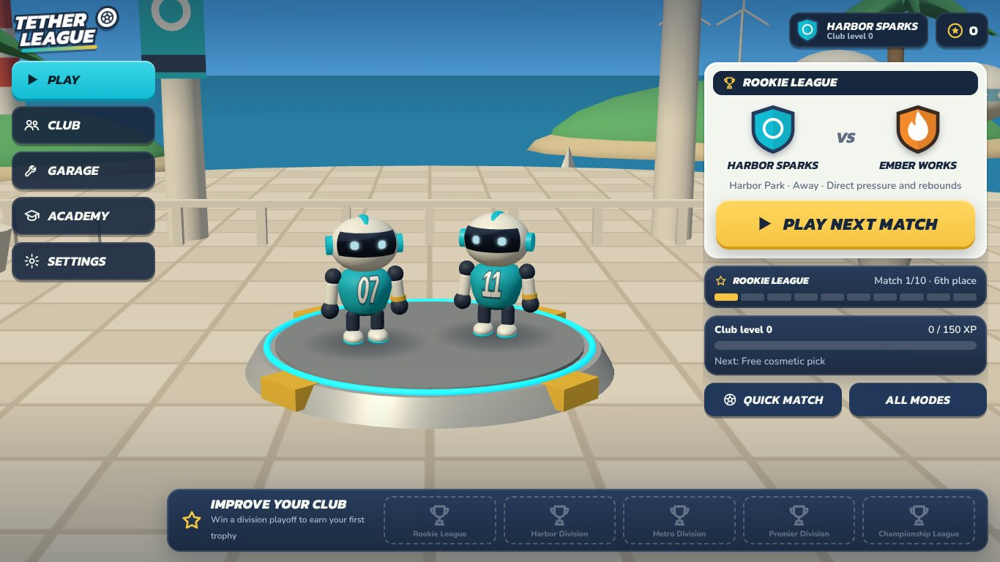
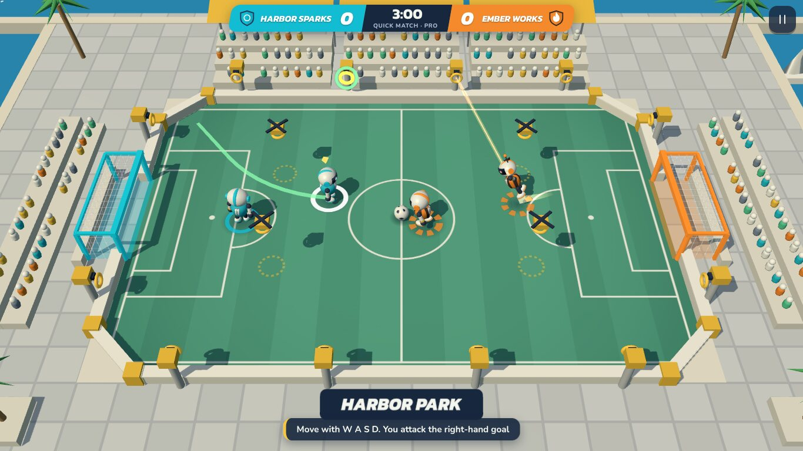

# Tether League

A 2v2 robot ball sport for the browser. Run, hold a tether to swing from a fixed anchor, let go to launch
with your momentum, and kick, pass and defend your way through a club career.

Single-player, offline, no accounts. Built from the design pack in [`design/`](design/README.md).




## Run it

Requires Node 20.19+ or 22.12+ (developed on Node 22).

```bash
npm install
```

```bash
npm run dev
```

Open the printed local URL. For a production build:

```bash
npm run build
```

```bash
npm run preview
```

`dist/` is a static site (relative paths), so it can be hosted from any folder on any static host.

To get a copy that plays by double-clicking `index.html`, with no server at all:

```bash
npm run build:offline
```

That writes `offline/`. It is the same game bundled as one classic script, because browsers block
module scripts on pages opened straight from disk.

## Controls

| Action | Mouse + keyboard | Keyboard only | Touch | Gamepad |
| --- | --- | --- | --- | --- |
| Move / steer a swing | WASD or arrows | same | hold or drag the stick (bottom left) | left stick |
| Aim | mouse pointer | follows movement | drag the KICK button | right stick |
| Swing: tap = launch toward your aim automatically | right mouse | Space / Left Shift | tap SWING | triggers / bumpers |
| Swing: tap again = let go now | tap again | tap again | tap again | tap again |
| Swing: hold = let go yourself (rope glows green when lined up) | hold right mouse | hold Space | hold SWING | hold trigger |
| Kick (one press; mashing scuffs the shot) | left mouse | J / Enter | tap KICK | A / X |
| Pass to teammate (without the ball: call for it) | K / F | K / F | tap PASS | B / Y |
| Override the chosen anchor | Q / E | Q / E | – | – |
| Pause | Esc / P | Esc / P | pause button | Start |

Swings go the way you are moving. Standing still, they go toward the cursor (if you used the mouse in
the last few seconds), otherwise the way your robot faces. A gamepad's right stick always wins. A swing
never starts backwards: if no anchor in reach can start you forward, none is highlighted.
The glowing anchor is the one you will swing from.
Keys can be rebound in Settings. F3 toggles a debug overlay during play.

## What is in the game

- **The sport**: three-minute 2v2 matches with sudden-death overtime, a free ball, deliberate kicks whose
  power grows with your momentum, a pass button that always finds your teammate (banking it off a
  side wall when an opponent blocks the lane, and calling for the ball when you don't have it),
  lively walls that kick the ball back with a little extra pace for crosses and wall passes,
  one-touch strikes off a teammate's pass, saves, interceptions, and a slow-motion goal celebration
  with fireworks and a camera push-in.
- **Smart swing**: tap to swing round the highlighted anchor and launch toward your aim (tap again to
  let go early); hold to swing manually and let go when the rope glows green. Swings are planned from
  real rope physics (anchor, direction and release point), and the bots use the same planner.
- **Club career**: five divisions of six clubs, a ten-match double round robin, four-team playoffs,
  promotion by winning the final, trophies and season history. The difficulty climbs gently; after a
  defeat the next opponent eases off (comeback boost), and opponents three goals up ease off too.
- **Quick Match**, **Academy** (five playable lessons), **six Skill Trials** with medals and personal bests,
  and a free **test drive** for every chassis.
- **Four chassis** (sidegrades), **four arenas**, earned cosmetics (faces, jerseys, trails, celebrations,
  badges, head accessories), club colours, titles, name and numbers.
- **Progression**: a 40-level Club Road with a reward at every level, three rotating club objectives,
  31 tiered achievements, chassis mastery, and season prize money. See the Progress screen.
- **Saves** in the browser with a backup snapshot, export/import and validation.
- **Settings**: audio, quality tiers, reduced motion, high contrast, text size, aim assist, aim mode,
  rebinding, touch layout.

## Project commands

| Command | Purpose |
| --- | --- |
| `npm run dev` | Development server |
| `npm run build` | Type-check and build to `dist/` |
| `npm run preview` | Serve the production build |
| `npm run build:offline` | Standalone build in `offline/` that runs from disk |
| `npm test` | Rule validation suite (242 tests) |
| `npm run check` | Type-check plus tests |
| `npm run sim -- 10 harbor_park club pro` | Headless bot-vs-bot matches for tuning |
| `npm run feasibility` | Brute-force check that trial layouts are achievable |
| `npm run swingcheck` | Smart-swing accuracy and time gain from random spots on each arena |
| `vite-node tools/swingdir.ts` | How often a swing starts backwards (should be 0%) |
| `npm run balance -- 12 mash,club 0,1,1.9` | Win rates and goals for stand-in players per division |
| `npm run sweep -- 8` | Broken-mechanics sweep over every arena |
| `npm run economy -- 150 7` | Progression pacing over 150 simulated matches |

## Layout

```
src/content/      tuning values, chassis, arenas, clubs, cosmetics, trials (all data)
src/game/sim/     fixed-step simulation and match rules (no DOM, deterministic per seed)
src/game/ai/      bots (same command interface as the player)
src/game/render/  Three.js views: robots, arenas, effects, menu stage
src/game/input/   keyboard, mouse, touch, gamepad -> commands
src/game/scenarios/  trials, lessons, test drive
src/career/       schedule, standings, playoffs
src/progression/  rewards, levels, purchases, idempotent result commits
src/storage/      save schema, validation, migration, snapshots, settings
src/ui/           DOM screens and styles
tests/            rule validation
tools/            headless tuning and validation scripts
design/           the original design pack and concept art
```

See [`BUILD_STATUS.md`](BUILD_STATUS.md) for what was verified, the design decisions taken, and what is
not done. Asset provenance is in [`ASSETS.md`](ASSETS.md).
